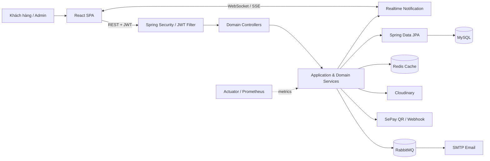
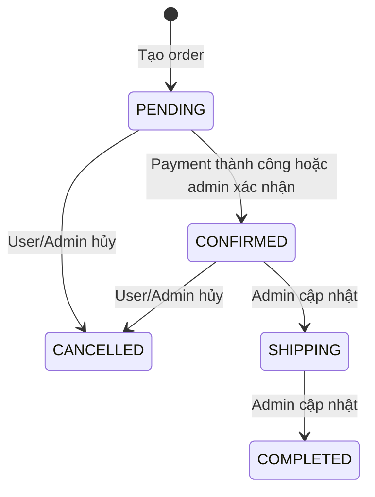

# Web Bán Sách

Web Bán Sách là một monorepo cho hệ thống thương mại điện tử bán sách, gồm giao diện React dành cho khách hàng và quản trị viên, backend Spring Boot cung cấp REST API, cùng bộ cấu hình hạ tầng phục vụ môi trường local và triển khai trên Kubernetes.

Source code là nguồn sự thật chính của dự án. Tài liệu này mô tả những thành phần đã được xác minh trong repository; trạng thái hoạt động của dịch vụ bên ngoài và môi trường triển khai được ghi rõ là `UNVERIFIED` khi chưa có kết quả kiểm thử runtime.

## 1. Project Overview

Hệ thống phục vụ ba nhóm truy cập:

- **Public**: đăng ký, xác nhận tài khoản, đăng nhập và duyệt catalog công khai.
- **USER**: quản lý hồ sơ, giỏ hàng, wishlist, voucher, đơn hàng, thanh toán và review.
- **ADMIN**: quản lý catalog, người dùng, đơn hàng, tồn kho, voucher, review và xem dashboard.

Ranh giới trách nhiệm chính:

- `front_end/` hiển thị storefront và trang quản trị, quản lý trạng thái giao diện và gọi backend API.
- `Back_end/` thực thi authentication, authorization, business rules, persistence và tích hợp dịch vụ ngoài.
- `infrastructure/` mô tả container, provisioning, Kubernetes và monitoring; đây không phải nơi chứa business logic.

## 2. System Scope & Core Features

| Domain | Chức năng đã xác minh | Trạng thái |
| --- | --- | --- |
| Account & Security | Đăng ký, xác nhận email, gửi lại mã xác nhận, đăng nhập JWT, quên/đặt lại mật khẩu, hồ sơ và đổi mật khẩu | `IMPLEMENTED` |
| Catalog | Danh sách/chi tiết sách, tìm kiếm và lọc; quản lý sách, tác giả, danh mục và ảnh bìa | `IMPLEMENTED` |
| Cart & Pricing | Thêm, sửa, xóa, làm rỗng giỏ; kiểm tra tồn kho; tính giá theo discount còn hiệu lực | `IMPLEMENTED` |
| Order | Checkout từ giỏ, buy-now, idempotency key, lịch sử đơn, hủy đơn và chuyển trạng thái | `IMPLEMENTED` |
| Inventory | Tra cứu tồn kho; admin set, adjust và reconcile; khóa bi quan khi cập nhật số lượng | `IMPLEMENTED` |
| Payment | Tạo QR SePay, nhận webhook, tra cứu trạng thái, thông báo qua WebSocket/SSE và email thành công | `IMPLEMENTED` |
| Voucher | Claim voucher, xem voucher đã nhận/khả dụng, dùng khi checkout và CRUD cho admin | `IMPLEMENTED` |
| Review & Wishlist | CRUD review, thống kê rating, kiểm tra quyền review theo đơn hoàn tất; quản lý wishlist | `IMPLEMENTED` |
| Admin Dashboard | Tổng hợp số liệu quản trị và cache kết quả | `IMPLEMENTED` |
| Runtime integrations | MySQL, Redis, RabbitMQ, SMTP, Cloudinary và SePay có code/configuration tương ứng | `UNVERIFIED` |
| Production deployment | Có cấu hình Terraform, Ansible, Kubernetes và GitHub Actions | `UNVERIFIED` |

Các tính năng không tồn tại trong source hiện tại và không được xem là đã triển khai: JWT refresh token, logout/revocation phía server, payment refund API và tích hợp OpenAPI/Swagger.

## 3. Technology Stack

### Frontend

| Thành phần | Công nghệ đã xác minh | Vai trò |
| --- | --- | --- |
| UI | React 19, TypeScript 6 | Storefront và admin application |
| Build | Vite 8 | Development server và production build |
| Routing | React Router 7 | Điều hướng public, protected và admin routes |
| HTTP | Axios | Gọi REST API và gắn token qua interceptor |
| Styling | Tailwind CSS 3 | Giao diện và responsive layout |
| Test | Vitest, Testing Library | Component/UI tests |

### Backend

| Thành phần | Công nghệ đã xác minh | Vai trò |
| --- | --- | --- |
| Runtime | Java 17, Spring Boot 4.0.1 | REST application |
| Web & validation | Spring MVC, Jakarta Validation | Controller, request binding và validation |
| Persistence | Spring Data JPA, Hibernate, MySQL | Transaction và lưu trữ dữ liệu |
| Security | Spring Security, JJWT 0.11.5, BCrypt | Stateless JWT authentication và RBAC |
| Cache | Redis | Cache catalog, review và dashboard |
| Messaging & email | RabbitMQ, Spring Mail | Gửi email nền và dead-letter flow |
| File storage | Cloudinary Java SDK 1.38.0 | Upload ảnh sách |
| Realtime | WebSocket/STOMP, SSE | Thông báo order/payment |
| Observability | Actuator, Micrometer Prometheus | Health check và metrics |
| Test | JUnit, Mockito, MockMvc, H2 | Unit, controller và integration tests |

### Infrastructure

Docker/Docker Compose hỗ trợ môi trường container; Terraform và Ansible chuẩn bị hạ tầng AWS/k3s; Kubernetes manifests mô tả application, datastore, ingress và monitoring; Prometheus/Grafana cung cấp metrics và dashboard.

## 4. System Architecture

Backend là một **modular monolith** tổ chức theo domain và áp dụng layered flow bên trong từng module. Source hiện tại không thể hiện đầy đủ các dependency boundary để được mô tả là Clean Architecture hoặc DDD.



Luồng xử lý HTTP điển hình:

```text
Request → Security filter chain → Controller → Service → Repository → MySQL
                                      ↓           ↓
                               ApiResponse    External services / cache / messaging
```

- Controller nhận request DTO và điều phối HTTP response.
- Service chứa business validation, transaction và phối hợp giữa các domain.
- Repository truy cập dữ liệu qua Spring Data JPA.
- Mapper chuyển entity sang response DTO.
- `common/` cung cấp response, exception handling, cache, logging và cấu hình dùng chung.
- `infrastructure/` hiện thực các adapter cho Cloudinary, SePay, email, messaging và realtime.

## 5. Repository Structure

```text
web_BanSach/
├── Back_end/
│   ├── src/main/java/com/example/web_bansach/
│   │   ├── common/          # Response, exception, cache, logging, shared config
│   │   ├── infrastructure/  # Cloudinary, email, RabbitMQ, SePay, persistence, realtime
│   │   ├── module/          # Các domain nghiệp vụ
│   │   └── security/        # JWT, filter chain, principal, 401/403 handlers
│   ├── src/test/            # Unit, controller và integration tests
│   ├── schema.sql
│   ├── data.sql
│   └── pom.xml
├── front_end/
│   ├── src/app/             # Bootstrap, providers và routes
│   ├── src/features/        # Feature theo domain và admin pages
│   ├── src/services/        # API, storage và WebSocket clients
│   ├── src/stores/          # Auth, cart và UI state
│   └── package.json
├── infrastructure/
│   ├── docker/              # Local, production và toolbox Compose files
│   ├── terraform/           # AWS resources
│   ├── ansible/             # k3s provisioning/deployment
│   ├── kubernetes/          # Workload, datastore, ingress và monitoring manifests
│   ├── monitoring/          # Prometheus và Grafana provisioning
│   └── setup_guide/         # Hướng dẫn hạ tầng hiện có
└── .github/workflows/       # CI/CD workflow hiện có
```

Các backend domain hiện có: `auth`, `user`, `book`, `author`, `category`, `cart`, `pricing`, `order`, `inventory`, `payment`, `voucher`, `review`, `wishlist` và `dashboard`.

## 6. Core Business Workflows

### 6.1 Đăng ký và xác nhận tài khoản

1. Backend kiểm tra email/username, mã hóa mật khẩu bằng BCrypt và tạo user chưa active với `ROLE_USER`.
2. Mã xác nhận 6 chữ số được sinh ngẫu nhiên; database chỉ lưu BCrypt hash.
3. Email được publish sau khi transaction commit qua RabbitMQ.
4. Mã có TTL, resend cooldown và giới hạn số lần nhập sai theo cấu hình.
5. Xác nhận thành công kích hoạt user; chỉ user active mới đăng nhập được.

### 6.2 Cart và checkout

1. Add/update cart kiểm tra sách khả dụng, quantity hợp lệ và tồn kho hiện tại.
2. Checkout khóa cart, kiểm tra lại toàn bộ inventory và tính giá hiện hành.
3. Voucher chỉ được dùng nếu thuộc user, chưa dùng và chưa hết hạn.
4. Order `PENDING` và các order item được lưu trong cùng transaction.
5. Inventory được khóa bằng pessimistic write lock và **trừ ngay khi tạo order**.
6. Checkout thành công đánh dấu voucher đã dùng, xóa cart item và phát realtime event.
7. Khi đơn được hủy hợp lệ, tồn kho được cộng trả.

Hệ thống không có mô hình giữ hàng (`stock reservation`) riêng. Checkout từ giỏ và buy-now đều hỗ trợ optional idempotency key theo từng user.

### 6.3 Order lifecycle



Order ở trạng thái `SHIPPING` hoặc `COMPLETED` không thể hủy. Order `COMPLETED` không thể chuyển ngược trạng thái.

### 6.4 SePay payment

1. User khởi tạo payment cho order thuộc chính mình; order phải là `PENDING` và amount phải khớp tổng tiền.
2. Backend tạo transaction code `SEP{orderId}`, URL QR và payment record trạng thái `PENDING`.
3. Webhook được đối chiếu bằng transaction code, amount và `Authorization` API key header.
4. Callback hợp lệ chuyển payment sang `SUCCESS`; order `PENDING` tương ứng chuyển sang `CONFIRMED`.
5. Backend phát realtime event và enqueue email xác nhận thanh toán sau commit.

Integration hiện tại tạo QR và xử lý webhook. Không có refund API hoặc remote payment-status API.

## 7. Authentication & Authorization

- Backend sử dụng stateless access JWT; không tạo HTTP session.
- JWT subject là email đăng nhập và chứa claims `userId`, `roles`.
- Client gửi token qua `Authorization: Bearer <token>`.
- Hai authority được sử dụng là `ROLE_USER` và `ROLE_ADMIN`.
- CORS origins được đọc từ application configuration.
- Public access gồm authentication endpoints, catalog category/author/book và SePay webhook.
- Cart, order, wishlist, voucher, review, inventory-user và payment status yêu cầu `ROLE_USER` hoặc `ROLE_ADMIN`.
- Các controller quản trị yêu cầu `ROLE_ADMIN`.
- Payment SSE nhận JWT qua query parameter, tự xác minh token và quyền sở hữu order trước khi subscribe.

JWT hiện chỉ là access token. Source không có refresh token, logout endpoint, token blacklist hoặc server-side revocation.

## 8. API Overview

Repository chưa áp dụng một global API prefix duy nhất. Các route hiện được chia theo controller convention:

| Nhóm | Route tiêu biểu | Access |
| --- | --- | --- |
| Authentication | `POST /tai-khoan/dang-ky`, `POST /tai-khoan/dang-nhap` | Public |
| Public catalog | `GET /user/books`, `GET /api/categories`, `GET /api/authors` | Public |
| User commerce | `/user/cart/**`, `/user/orders/**`, `/user/vouchers/**` | USER, ADMIN |
| Payment | `/api/payment/**` | Mixed: authenticated status/initiate, public webhook, token-validated SSE |
| Administration | `/admin/**`, `/api/admin/**`, `/user_for_admin/**` | ADMIN |

Response thành công và phần lớn application error dùng `ApiResponse`:

```json
{
  "statusCode": 200,
  "message": "Thành công",
  "data": {},
  "timestamp": "..."
}
```

Response phân trang đặt danh sách trong `content` và metadata trong `meta`. Bean Validation xử lý constraint của request DTO; `GlobalExceptionHandler` ánh xạ business/validation/not-found/system exception sang HTTP 400/404/500.

Lỗi 401/403 phát sinh trong Spring Security hiện dùng `ErrorResponse` với các trường `code`, `message`, `status`, `timestamp` và `path`; schema này khác `ApiResponse`.

## 9. Documentation

### Tài liệu hiện có

| Tài liệu | Nội dung |
| --- | --- |
| [Backend README](Back_end/README.md) | Tài liệu backend cũ; cần tiếp tục đối chiếu với source trước khi sử dụng |
| [Database schema](Back_end/schema.sql) | DDL MySQL hiện có |
| [Sample data](Back_end/data.sql) | Dữ liệu mẫu/import thủ công |
| [Frontend README](front_end/README.md) | Ghi chú cho frontend |
| [Infrastructure overview](infrastructure/INFRASTRUCTURE_OVERVIEW.md) | Vai trò các thành phần infrastructure |
| [Infrastructure setup guide](infrastructure/setup_guide/INSTALLATION.md) | Hướng dẫn provisioning và deployment riêng |
| [Ansible README](infrastructure/ansible/README.md) | Ghi chú AWS/k3s bằng Ansible |

README gốc không chứa hướng dẫn production chi tiết; các thao tác Docker, Terraform, Ansible, Kubernetes, HTTPS, monitoring và CI/CD được giữ trong tài liệu infrastructure.

### Documentation structure đề xuất

Cấu trúc dưới đây là kế hoạch cho bước tài liệu hóa tiếp theo; **các file chưa được tạo**.

```text
docs/
├── architecture/
│   ├── system-architecture.md
│   └── module-dependencies.md
├── workflows/
│   ├── authentication.md
│   ├── cart-order-inventory.md
│   └── payment-sepay.md
├── database/
│   ├── data-model.md
│   └── schema-management.md
├── api/
│   ├── api-conventions.md
│   └── endpoint-catalog.md
├── security/
│   ├── authentication-authorization.md
│   └── external-callback-security.md
└── testing/
    └── testing-strategy.md
```

| Tài liệu đề xuất | Mục đích và phạm vi | Source liên quan | Ưu tiên | Không lặp lại README |
| --- | --- | --- | --- | --- |
| `architecture/system-architecture.md` | Component view, runtime interaction, external dependencies và deployment-neutral architecture | `Back_end/.../module`, `common`, `infrastructure`, `security`; `front_end/src`; `infrastructure/` | P0 | Không lặp overview, stack table hoặc cây repository |
| `architecture/module-dependencies.md` | Dependency map giữa các backend domain, shared components và infrastructure ports | Service constructors/imports trong `module/**`, `PaymentGateway`, `FileUploadService`, `EmailPublisher` | P1 | Không mô tả lại từng feature cho người dùng cuối |
| `workflows/authentication.md` | Registration, verification, login, reset password; TTL, retry và transaction behavior | `AuthController`, `AuthServiceImpl`, `AccountVerificationServiceImpl`, JWT classes | P0 | Không lặp bảng role/access tổng quan |
| `workflows/cart-order-inventory.md` | Cart validation, pricing, checkout/buy-now, idempotency, voucher, locking, deduction và restoration | `cart`, `order`, `inventory`, `pricing`, `voucher` modules | P0 | Không liệt kê toàn bộ endpoint hoặc DTO field |
| `workflows/payment-sepay.md` | Payment state, QR creation, webhook verification, order sync, SSE/WebSocket và email | `payment` module, `SePayGateway`, realtime và email infrastructure | P0 | Không chứa credential/setup production |
| `database/data-model.md` | Entity relationship, ownership, unique constraints, soft delete và important indexes | Entity/repository classes, `schema.sql` | P0 | Không sao chép toàn bộ DDL |
| `database/schema-management.md` | Xác định nguồn schema, Hibernate `ddl-auto`, seed/import flow và migration policy sau khi được quyết định | `application.properties`, `schema.sql`, `data.sql`, manifests/Compose config | P0 | Không lặp hướng dẫn deploy/import chi tiết |
| `api/api-conventions.md` | Route prefixes, request validation, response/error schema, pagination và naming conventions thực tế | Controllers, DTOs, `ApiResponse`, `PageResponse`, exception/security handlers | P0 | Không tạo endpoint reference dài |
| `api/endpoint-catalog.md` | Catalog machine-maintainable theo method/path/access/request/response và implementation status | Tất cả controller, `SecurityConfig`, `Endpoints` | P1 | Không giải thích architecture hoặc business workflow |
| `security/authentication-authorization.md` | JWT claims/lifetime, filter chain, CORS, public/user/admin rule và method security | `security/**`, user/auth services | P0 | Không lặp flow đăng ký chi tiết |
| `security/external-callback-security.md` | Trust boundary cho SePay webhook, SSE query token, WebSocket exposure và email/message broker | `PaymentController`, `SePayGateway`, `SecurityConfig`, WebSocket/RabbitMQ config | P1 | Không chứa secret, key hoặc giá trị môi trường thật |
| `testing/testing-strategy.md` | Test pyramid hiện có, test fixtures/profile, coverage gaps và cách phân loại unit/controller/integration | `Back_end/src/test`, `front_end/src/tests`, test configuration | P1 | Không lặp lệnh setup/deployment |

## 10. Project Status & Known Limitations

### Đã xác minh trong source

- Backend có 14 domain package và sử dụng Spring MVC/JPA theo layered architecture.
- Frontend có storefront, authentication pages và các màn hình quản trị theo feature.
- Backend có unit, controller và integration tests; test profile dùng H2 và tắt external Redis/RabbitMQ listener.
- Redis caching, RabbitMQ email, WebSocket, SSE, Actuator và Prometheus đã có implementation/configuration.
- Các transaction quan trọng của cart/order/inventory/payment sử dụng transaction boundary và pessimistic locking tại các điểm cập nhật đồng thời.

### Hạn chế đã biết

- Không có refresh token, server-side logout/revocation hoặc payment refund.
- API route prefix chưa thống nhất giữa `/tai-khoan`, `/user`, `/admin`, `/api` và `/user_for_admin`.
- Application errors và Spring Security errors chưa dùng cùng response schema.
- Payment status dùng chuỗi thay vì enum; trạng thái runtime cần tuân theo `PENDING`, `SUCCESS`, `FAILED`, `CANCELLED`.
- `schema.sql` chưa khai báo hai bảng `account_verification_codes` và `password_reset_tokens` đang có JPA entity; hiệu lực schema phụ thuộc cách khởi tạo database của từng môi trường.
- `Back_end/README.md` là tài liệu legacy và có một số cấu trúc/class không còn khớp source hiện tại.

### UNVERIFIED

- Test suite có pass hoàn toàn trên máy mới hoặc CI hay không.
- Cloudinary upload, SMTP delivery, RabbitMQ DLQ, Redis cache và SePay webhook trong môi trường tích hợp thực.
- WebSocket/SSE hoạt động end-to-end qua reverse proxy hoặc Kubernetes ingress.
- Infrastructure manifests và GitHub Actions có khớp với môi trường production đang vận hành hay không.
- Database đang được khởi tạo bằng Hibernate, `schema.sql` hay quy trình import riêng.
