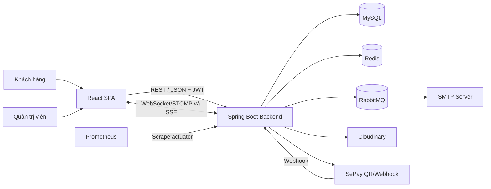
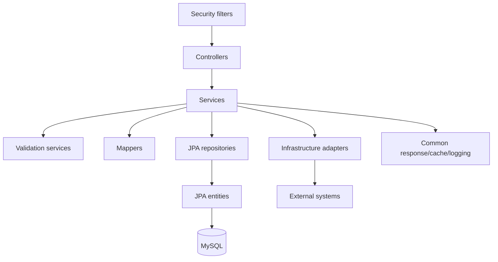
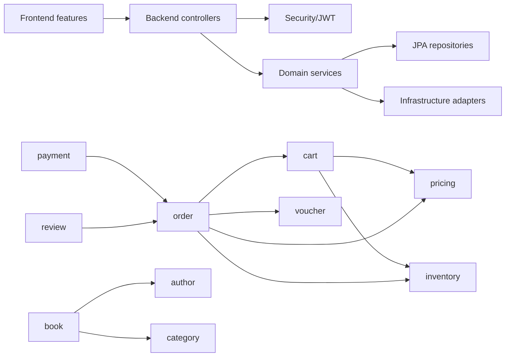
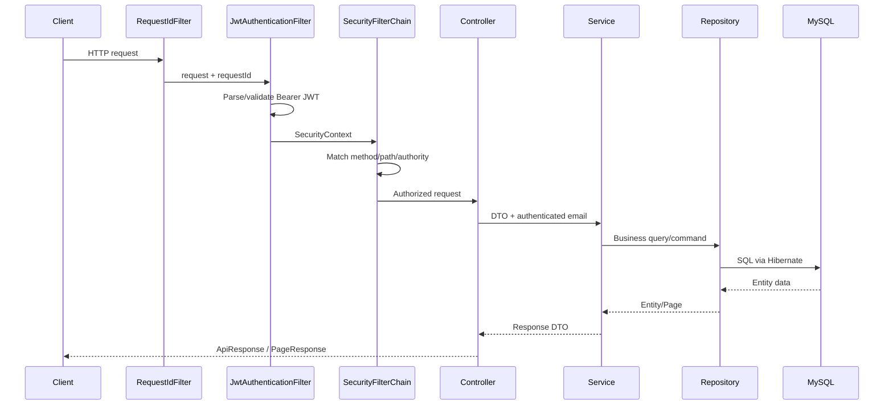

# Kiến trúc hệ thống Web Bán Sách

## Mục đích

Tài liệu mô tả kiến trúc đang tồn tại trong repository: ranh giới frontend/backend, cấu trúc backend, dependency giữa module, luồng request và các tích hợp ngoài. Nội dung deployment chi tiết không thuộc phạm vi tài liệu này.

## Scope và nguồn kiểm chứng

- Frontend: [`front_end/src`](../../front_end/src), [`front_end/package.json`](../../front_end/package.json).
- Backend bootstrap và cấu hình: [`WebBansachApplication`](../../Back_end/src/main/java/com/example/web_bansach/WebBansachApplication.java), [`application.properties`](../../Back_end/src/main/resources/application.properties).
- Backend domain: [`module`](../../Back_end/src/main/java/com/example/web_bansach/module).
- Shared/integration/security: [`common`](../../Back_end/src/main/java/com/example/web_bansach/common), [`infrastructure`](../../Back_end/src/main/java/com/example/web_bansach/infrastructure), [`security`](../../Back_end/src/main/java/com/example/web_bansach/security).

Trạng thái runtime của external services và production deployment là **UNVERIFIED**.

## 1. Architecture Overview

Repository là một monorepo gồm React SPA, một Spring Boot application và cấu hình infrastructure. Backend triển khai dưới dạng **modular monolith**: một process Spring Boot và một Maven module, nhưng source được nhóm theo các domain nghiệp vụ. Bên trong mỗi domain, code đi theo layered flow `Controller → Service → Repository → Database`.

Không có đủ dependency boundary để gọi hệ thống là Clean Architecture, Hexagonal Architecture hoặc DDD. Service có thể phụ thuộc trực tiếp JPA repository/entity và gọi service của domain khác; ví dụ [`OrderUserService`](../../Back_end/src/main/java/com/example/web_bansach/module/order/service/OrderUserService.java) phối hợp user, cart, book, inventory, voucher, pricing và realtime.

## 2. System Context

### Thành phần phía người dùng

**React SPA** phục vụ cả storefront và trang quản trị. Frontend định tuyến theo
nhóm public, user và admin; gọi REST API và nhận cập nhật realtime.

Nguồn: [`app/routes`](../../front_end/src/app/routes),
[`services`](../../front_end/src/services).

### Thành phần ứng dụng

**Spring Boot backend** chịu trách nhiệm security, business rules, transaction,
persistence và điều phối các integration. Đây là nơi giữ trạng thái nghiệp vụ
chuẩn của hệ thống.

Nguồn: [`Back_end/src/main/java`](../../Back_end/src/main/java).

### Thành phần dữ liệu và tích hợp

- **MySQL** — persistent store chính qua Spring Data JPA/Hibernate.
- **Redis** — cache books, authors, categories, reviews và dashboard; không phải
  source of truth.
- **RabbitMQ và SMTP** — gửi email nền, retry và chuyển message thất bại sang
  failed queue.
- **Cloudinary** — lưu ảnh sách được upload từ chức năng quản trị.
- **SePay** — tạo URL QR và xác thực webhook bằng API-key header.
- **WebSocket/SSE** — phát sự kiện order/payment và stream trạng thái payment.

Source liên quan đến integration

- [`RedisCacheConfig`](../../Back_end/src/main/java/com/example/web_bansach/common/config/RedisCacheConfig.java)
- [`RabbitMQConfig`](../../Back_end/src/main/java/com/example/web_bansach/infrastructure/messaging/rabbitmq/RabbitMQConfig.java)
- [`EmailQueueConsumer`](../../Back_end/src/main/java/com/example/web_bansach/infrastructure/email/messaging/EmailQueueConsumer.java)
- [`CloudinaryFileUploadService`](../../Back_end/src/main/java/com/example/web_bansach/infrastructure/file/impl/CloudinaryFileUploadService.java)
- [`SePayGateway`](../../Back_end/src/main/java/com/example/web_bansach/infrastructure/payment/SePayGateway.java)
- [`RealtimeNotificationService`](../../Back_end/src/main/java/com/example/web_bansach/infrastructure/realtime/RealtimeNotificationService.java)

## 3. Backend Architecture

- `controller`: HTTP mapping, authentication principal, request binding và response wrapping.
- `service`: business rules, orchestration và transaction boundary. Một số domain tách command/query/validation interface; một số domain dùng một concrete service.
- `repository`: `JpaRepository` và JPQL query; các thao tác cạnh tranh sử dụng `PESSIMISTIC_WRITE` tại cart, order, inventory, voucher, user-voucher và payment.
- `entity`: JPA mapping trực tiếp tới schema quan hệ.
- `dto`: request/response contract, với Jakarta Validation trên các DTO quan trọng.
- `mapper`: chuyển entity sang DTO; mapping không phải persistence boundary độc lập.

Các response thường được đóng gói bằng [`ApiResponse`](../../Back_end/src/main/java/com/example/web_bansach/common/response/ApiResponse.java); phân trang dùng [`PageResponse`](../../Back_end/src/main/java/com/example/web_bansach/common/response/PageResponse.java). Security 401/403 sử dụng schema [`ErrorResponse`](../../Back_end/src/main/java/com/example/web_bansach/common/exception/ErrorResponse.java) riêng.

## 4. Module Boundaries & Responsibilities

### Identity

- **`auth`** quản lý verification code, reset token và email template. Module này
  phụ thuộc user và email infrastructure.
- **`user`** xử lý registration/login, profile, password và admin user
  management; phụ thuộc auth, JWT và email.

### Catalog

- **`book`** quản lý catalog, CRUD admin, image upload và discount association;
  sử dụng author, category, inventory và file adapter.
- **`author`** cung cấp public query và admin CRUD, có cache.
- **`category`** cung cấp public query, CRUD và activate/deactivate; khi xóa có
  kiểm tra category đang được book sử dụng.
- **`pricing`** tính giá từ book và discount đang có hiệu lực.

### Commerce

- **`cart`** quản lý item, validation và tổng giá; sử dụng user, book, inventory
  và pricing.
- **`order`** điều phối checkout, buy-now, lịch sử, cancel và state transition;
  đây là module có nhiều dependency nhất: cart, inventory, pricing, voucher và
  realtime.
- **`inventory`** quản lý quantity theo book.
- **`payment`** xử lý init/status/webhook; phụ thuộc order, SePay adapter,
  realtime và email.
- **`voucher`** quản lý claim, ownership, use và CRUD admin.

### Engagement và reporting

- **`review`** quản lý review/statistics và kiểm tra user đã mua sách qua order.
- **`wishlist`** quản lý danh sách sách yêu thích của user.
- **`dashboard`** tổng hợp dữ liệu từ user, book, order và payment repositories.

Module boundaries là ranh giới tổ chức source, không phải ranh giới triển khai hoặc transaction độc lập.

## 5. Dependency Flow

Không có compile-time enforcement ngăn module truy cập repository của module khác. Dependency map chi tiết nên được duy trì theo constructor/import thực tế, không theo tên package dự kiến.

## 6. Request Processing Flow

Nguồn: [`RequestIdFilter`](../../Back_end/src/main/java/com/example/web_bansach/common/logging/RequestIdFilter.java), [`JwtAuthenticationFilter`](../../Back_end/src/main/java/com/example/web_bansach/security/jwt/JwtAuthenticationFilter.java), [`SecurityConfig`](../../Back_end/src/main/java/com/example/web_bansach/security/config/SecurityConfig.java).

Exception từ application được chuyển đổi bởi [`GlobalExceptionHandler`](../../Back_end/src/main/java/com/example/web_bansach/common/exception/GlobalExceptionHandler.java). Lỗi xảy ra trước controller được xử lý bởi `JwtAuthenticationEntryPoint` hoặc `JwtAccessDeniedHandler`.

## 7. External Service Integrations và Data Flow

### Redis

Spring Cache lưu kết quả query catalog/review/dashboard với TTL theo cache name. Command service evict cache liên quan. Redis không được dùng làm repository hoặc source of truth. Nếu Redis không khả dụng, hành vi runtime chưa được kiểm chứng.

### RabbitMQ và Email

`EmailPublisher.publishAfterCommit` đăng ký callback transaction synchronization; chỉ publish sau commit khi có transaction active. Consumer gọi SMTP sender, và RabbitMQ queue có dead-letter routing. Email verification, welcome, password reset và payment success dùng flow này.

### Cloudinary

`BookCommandServiceImpl` gọi `FileUploadService`; implementation hiện tại upload qua Cloudinary. Database chỉ lưu URL/identifier ảnh trong trường `Book.coverImage`.

### SePay

Backend tạo URL QR dựa trên bank account configuration và payment code `SEP{orderId}`. SePay gọi public webhook; backend kiểm tra code, amount và `Authorization` header trước khi cập nhật payment/order. Không có refund hoặc remote status API.

### WebSocket và SSE

STOMP endpoint là `/ws`; broker destinations dùng `/topic` và `/queue`. `RealtimeNotificationService` phát order/payment event. Payment SSE dùng `GET /api/payment/sse/order/{orderId}?token=...`, tự xác minh JWT và ownership trước khi đăng ký emitter.

## 8. Architectural Decisions Có Bằng Chứng

- **Stateless JWT:** `SessionCreationPolicy.STATELESS`, CSRF disabled và không có
  server session.
- **Package-by-domain modular monolith:** toàn bộ domain chạy trong một Spring
  Boot application và nằm dưới `module/*`.
- **MySQL là persistent store:** H2 chỉ xuất hiện trong test profile.
- **Redis chỉ là cache:** Redis repositories bị disable.
- **Email đi qua broker:** publisher/consumer dùng RabbitMQ và hỗ trợ
  publish-after-commit.
- **Inventory giảm tại checkout:** `createOrder` và `buyNow` trừ quantity; không
  có reservation entity.
- **Concurrency dựa vào database lock:** các repository `find...ForUpdate` dùng
  `PESSIMISTIC_WRITE`.
- **Realtime không phải source of truth:** WebSocket/SSE chỉ phát snapshot/event;
  trạng thái chuẩn vẫn nằm trong MySQL.

Chi tiết order/payment nằm tại [Order & Payment Workflow](../04-business/order-payment-workflow.md); security tại [Security Design](../05-security/security-design.md).

## 9. Architectural Limitations & Technical Risks

- Module boundary không được enforce; cross-domain repository coupling làm tăng chi phí tách module.
- Route prefix không thống nhất: `/tai-khoan`, `/user`, `/admin`, `/api`, `/user_for_admin`.
- Application error và security error có hai schema khác nhau.
- Payment status là `String`, trong khi order status là enum.
- Query token của SSE có thể xuất hiện trong browser/proxy logs; cần security review.
- WebSocket broker destinations được `permitAll`; message-level authorization không được phát hiện trong source.
- Không có migration tool như Flyway/Liquibase; quan hệ giữa Hibernate `ddl-auto` và `schema.sql` phụ thuộc môi trường.
- Event publication cho realtime diễn ra trong service; không có transactional outbox. Khả năng mất event khi downstream lỗi là **UNVERIFIED**.
- Redis, RabbitMQ, SMTP, Cloudinary, SePay và realtime end-to-end chưa được kiểm chứng trong audit này.

## 10. Unverified Findings

- Topology và availability thực tế của production runtime.
- Hành vi degrade khi Redis/RabbitMQ/SMTP không khả dụng.
- Tính tương thích webhook SePay với payload production ngoài các field controller đang chấp nhận.
- WebSocket/SSE qua ingress hoặc reverse proxy.
- Performance, capacity và transaction contention dưới tải đồng thời.

