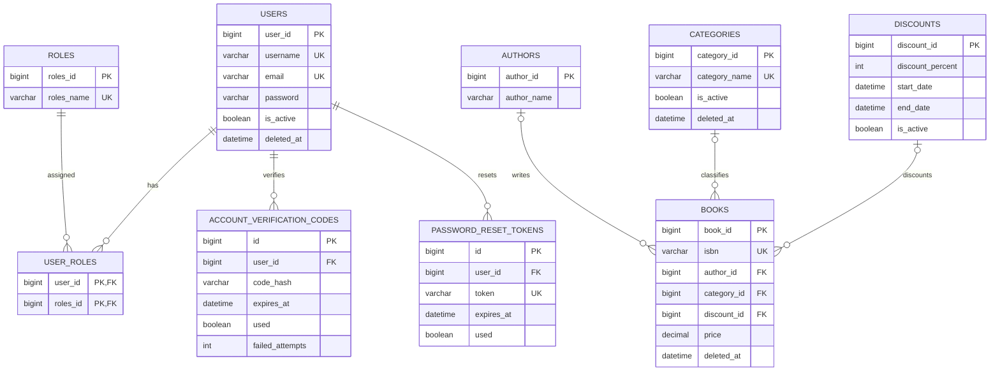
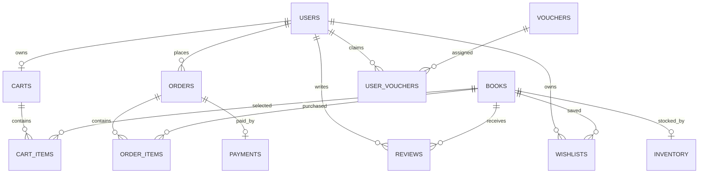

# Thiết kế cơ sở dữ liệu

## Mục đích

Tài liệu mô tả JPA model và DDL đang có, chỉ ra quan hệ, constraint, transaction boundary và các điểm không đồng bộ. Tài liệu không thực hiện migration và không coi `schema.sql` là nguồn duy nhất khi source entity khác biệt.

## Scope và nguồn kiểm chứng

- JPA entities: [`Back_end/src/main/java/com/example/web_bansach/module`](../../Back_end/src/main/java/com/example/web_bansach/module).
- Base auditing: [`BaseEntity`](../../Back_end/src/main/java/com/example/web_bansach/infrastructure/persistence/BaseEntity.java).
- DDL: [`schema.sql`](../../Back_end/schema.sql).
- Runtime configuration: [`application.properties`](../../Back_end/src/main/resources/application.properties).

## 1. Database Overview

Backend dùng MySQL và Spring Data JPA/Hibernate. Primary key số sử dụng `IDENTITY`, ngoại trừ `wishlists` dùng embedded composite key `(user_id, book_id)`. Test profile dùng H2 ở MySQL compatibility mode.

`spring.jpa.hibernate.ddl-auto` lấy từ biến môi trường và mặc định là `update`. Repository không có Flyway/Liquibase. Vì vậy schema runtime có thể khác `schema.sql`; cách bootstrap database của từng môi trường là **UNVERIFIED**.

## 2. Entity và Table Mapping

- **`Users` · `users`**
  - Primary key: `user_id`
  - Quan hệ chính: many-to-many `Roles`
- **`Roles` · `roles`**
  - Primary key: `roles_id`
  - Quan hệ chính: join qua `user_roles`
- **`AccountVerificationCode` · `account_verification_codes`**
  - Primary key: `id`
  - Quan hệ chính: many-to-one `Users`
- **`PasswordResetToken` · `password_reset_tokens`**
  - Primary key: `id`
  - Quan hệ chính: many-to-one `Users`
- **`Author` · `authors`**
  - Primary key: `author_id`
  - Quan hệ chính: được `Book` tham chiếu
- **`Category` · `categories`**
  - Primary key: `category_id`
  - Quan hệ chính: được `Book` tham chiếu; kế thừa audit fields
- **`Discount` · `discounts`**
  - Primary key: `discount_id`
  - Quan hệ chính: được `Book` tham chiếu
- **`Book` · `books`**
  - Primary key: `book_id`
  - Quan hệ chính: many-to-one author/category/discount
- **`Inventory` · `inventory`**
  - Primary key: `id`
  - Quan hệ chính: many-to-one `Book`; DDL unique `book_id`
- **`Cart` · `carts`**
  - Primary key: `cart_id`
  - Quan hệ chính: many-to-one `Users`; DDL unique `user_id`
- **`CartItem` · `cart_items`**
  - Primary key: `cart_item_id`
  - Quan hệ chính: many-to-one cart/book
- **`Order` · `orders`**
  - Primary key: `order_id`
  - Quan hệ chính: many-to-one user
- **`OrderItem` · `order_items`**
  - Primary key: `order_item_id`
  - Quan hệ chính: many-to-one order/book
- **`Payment` · `payments`**
  - Primary key: `id`
  - Quan hệ chính: one-to-one order
- **`Voucher` · `vouchers`**
  - Primary key: `voucher_id`
  - Quan hệ chính: được `UserVoucher` tham chiếu
- **`UserVoucher` · `user_vouchers`**
  - Primary key: `id`
  - Quan hệ chính: many-to-one user/voucher
- **`Review` · `reviews`**
  - Primary key: `id`
  - Quan hệ chính: many-to-one user/book
- **`Wishlist` · `wishlists`**
  - Primary key: `(user_id, book_id)`
  - Quan hệ chính: many-to-one user/book với `@MapsId`

Nguồn entity cụ thể nằm trong các package `module/*/entity`, ví dụ [`Order`](../../Back_end/src/main/java/com/example/web_bansach/module/order/entity/Order.java), [`Payment`](../../Back_end/src/main/java/com/example/web_bansach/module/payment/entity/Payment.java) và [`UserVoucher`](../../Back_end/src/main/java/com/example/web_bansach/module/voucher/entity/UserVoucher.java).

## 3. ERD — Identity và Catalog

Hai bảng auth trong ERD đến từ JPA entity nhưng **không được khai báo trong `schema.sql`**.

## 4. ERD — Commerce

Cardinality `Cart`/`Inventory` là one-to-one theo DDL unique constraint, mặc dù JPA mapping dùng `@ManyToOne`. `Payment.order` là `@OneToOne` và DDL cũng unique `order_id`.

## 5. Important Fields và Integrity Rules

### Identity

- `users.username`, `users.email`, `roles.roles_name` là unique trong DDL và JPA annotations.
- Mật khẩu user và verification code được lưu dưới dạng BCrypt hash; password-reset token hiện lưu token trực tiếp.
- `Users.deletedAt` biểu diễn soft delete. User queries quản trị dùng `deletedAt IS NULL` tại [`UserRepository`](../../Back_end/src/main/java/com/example/web_bansach/module/user/repository/UserRepository.java).
- Verification code có `expiresAt`, `used`, `failedAttempts`; reset token có `expiresAt`, `used`.

### Catalog

- `books.isbn` unique trong `schema.sql`; [`BookValidationServiceImpl`](../../Back_end/src/main/java/com/example/web_bansach/module/book/service/impl/BookValidationServiceImpl.java) cũng kiểm tra trùng.
- `Book.deletedAt` dùng để loại sách khỏi catalog; category kế thừa `createdAt`, `updatedAt`, `deletedAt` từ `BaseEntity`.
- `Discount` hợp lệ theo `isActive`, `startDate`, `endDate`; giá được tính tại [`PricingServiceImpl`](../../Back_end/src/main/java/com/example/web_bansach/module/pricing/service/impl/PricingServiceImpl.java).

### Cart, Order và Payment

- DDL giới hạn một cart cho mỗi user qua `uk_carts_user_id`.
- `orders(user_id, idempotency_key)` unique; `NULL` key vẫn cho phép nhiều order theo semantics MySQL.
- `orders.status` có check constraint gồm `PENDING`, `CONFIRMED`, `SHIPPING`, `COMPLETED`, `CANCELLED`.
- `order_items.price` là unit price snapshot tại lúc tạo order.
- `payments.order_id` và `payments.transaction_id` unique; một order có tối đa một payment record.
- Payment status là chuỗi; service chấp nhận `PENDING`, `SUCCESS`, `FAILED`, `CANCELLED`.

### Inventory và Voucher

- DDL unique `inventory.book_id`, nên mỗi book có tối đa một inventory row.
- Service không cho quantity sau set/adjust/reconcile nhỏ hơn 0; DDL không có check constraint quantity.
- `vouchers.code` và `(user_vouchers.user_id, voucher_id)` unique.
- Voucher quantity giảm khi claim; việc dùng voucher đánh dấu `UserVoucher.used`, không giảm `Voucher.quantity` lần thứ hai.

### Review và Wishlist

- Rating được request validation giới hạn 1–5, nhưng `schema.sql` không có check constraint.
- Service ngăn user tạo nhiều review cho cùng book bằng query check; DDL không có unique `(user_id, book_id)` cho reviews.
- Wishlist dùng composite primary key `(user_id, book_id)`, tự đảm bảo một book chỉ xuất hiện một lần trong wishlist của user.

## 6. Keys, Foreign Keys và Indexes

Chỉ các index được khai báo trong `schema.sql` được liệt kê dưới đây:

- **`roles` · unique `roles_name`**
- **`users` · unique `username`, unique `email`**
- **`user_roles` · PK `(user_id, roles_id)`, index `roles_id`**
- **`categories` · unique `category_name`**
- **`books` · unique `isbn`; indexes `author_id`, `category_id`, `discount_id`**
- **`inventory` · unique `book_id`**
- **`carts` · unique `user_id`**
- **`cart_items` · indexes `cart_id`, `book_id`**
- **`orders` · unique `(user_id, idempotency_key)`, index `user_id`**
- **`order_items` · indexes `order_id`, `book_id`**
- **`payments` · unique `order_id`, unique `transaction_id`**
- **`reviews` · indexes `user_id`, `book_id`**
- **`vouchers` · unique `code`**
- **`user_vouchers` · unique `(user_id, voucher_id)`, index `voucher_id`**
- **`wishlists` · PK `(user_id, book_id)`, index `book_id`**

Foreign-key delete actions đáng chú ý: user→cart/review/wishlist/user-role/user-voucher dùng cascade; user→order dùng set null; book→order-item/cart-item dùng restrict; order→order-item/payment dùng cascade. Đây là constraint từ `schema.sql`; JPA cascade không đồng nhất hoàn toàn với các hành vi này.

## 7. Transaction Boundaries

- **Register/verify/reset password · `@Transactional`; verification repository có pessimistic lock cho code active**
- **Cart command · `@Transactional`; add/update/remove/clear hiện đọc cart không khóa bi quan**
- **Checkout từ cart · `rollbackFor = Exception`; khóa cart bằng `findByUserIdForUpdate` và khóa từng inventory**
- **Checkout/buy-now · `rollbackFor = Exception`; lock cart/inventory; lưu order/items, voucher và clear cart cùng transaction**
- **Cancel order · `rollbackFor = Exception`; lock inventory khi hoàn quantity**
- **Inventory admin · `@Transactional`; lock inventory by id**
- **Voucher claim/use · `rollbackFor = Exception`; lock voucher hoặc owned voucher**
- **Payment init · `rollbackFor = Exception`; lock order**
- **Payment callback · `rollbackFor = Exception`; lock payment theo transaction id**

Nguồn: [`OrderUserService`](../../Back_end/src/main/java/com/example/web_bansach/module/order/service/OrderUserService.java), [`InventoryRepository`](../../Back_end/src/main/java/com/example/web_bansach/module/inventory/repository/InventoryRepository.java), [`VoucherRepository`](../../Back_end/src/main/java/com/example/web_bansach/module/voucher/repository/VoucherRepository.java), [`PaymentRepository`](../../Back_end/src/main/java/com/example/web_bansach/module/payment/repository/PaymentRepository.java).

## 8. Soft Delete Strategy

- `Users.deletedAt`: admin delete là soft delete; repository danh sách lọc row đã xóa.
- `Book.deletedAt`: catalog query và business validation loại sách đã xóa.
- `Category.deletedAt`: field tồn tại qua `BaseEntity`; category còn có `isActive`. Cách mọi query xử lý đồng thời hai cờ cần được giữ nhất quán.
- Các entity khác chủ yếu bị xóa vật lý hoặc đổi trạng thái; không có global Hibernate `@SQLDelete`/`@Where` được phát hiện.

## 9. Schema Management và Mismatch

- **Verification codes · Có entity/table mapping**
  - `schema.sql`: Thiếu table
  - Tác động: Import DDL thuần không đủ cho registration verification
- **Password reset tokens · Có entity/table mapping**
  - `schema.sql`: Thiếu table
  - Tác động: Forgot/reset password phụ thuộc Hibernate tạo bổ sung
- **Order tracking code · Không có field trong `Order`**
  - `schema.sql`: Có `tracking_code`
  - Tác động: Cột hiện không được application sử dụng
- **Inventory timestamp · Entity không có `updatedAt`**
  - `schema.sql`: Có `updated_at`
  - Tác động: Cột không được JPA quản lý rõ ràng
- **Cart/inventory cardinality · JPA `ManyToOne`**
  - `schema.sql`: DDL unique FK
  - Tác động: Model object không biểu đạt constraint one-to-one
- **Book ISBN · Entity không đặt `unique=true`**
  - `schema.sql`: DDL unique
  - Tác động: Integrity phụ thuộc DDL/runtime schema

Không có bằng chứng repository tự động chạy `schema.sql`. `ddl-auto=update` mặc định có thể che mismatch ở một số môi trường nhưng không thay thế migration có version.

## 10. Risks & Limitations

- Không có schema migration/version history; rollback và reproducibility là **UNVERIFIED**.
- Business constraints quantity/rating/discount không được đảm bảo đầy đủ ở database level.
- Review uniqueness được enforce bằng service check thay vì unique constraint, có race condition tiềm năng.
- DDL và JPA nullability/cascade không hoàn toàn đồng bộ.
- `Payment` cascade remove tới `Order` theo `@OneToOne(cascade = REMOVE)` cần review kỹ vì hướng cascade có thể xóa order khi xóa payment; runtime behavior chưa được kiểm thử trong audit này.
- Pessimistic lock phụ thuộc database/transaction configuration; behavior dưới tải đồng thời là **UNVERIFIED**.
- Seed data trong [`data.sql`](../../Back_end/data.sql) là dữ liệu mẫu, không phải migration hoặc production source of truth.

## 11. Unverified Findings

- Schema production thực tế và lịch sử thay đổi schema.
- MySQL version/configuration đang chạy và mức hỗ trợ check constraint.
- Database bootstrap path trong từng environment.
- Referential actions thực tế nếu Hibernate tạo schema thay vì dùng `schema.sql`.
- Backup, restore, retention và data classification policy.
