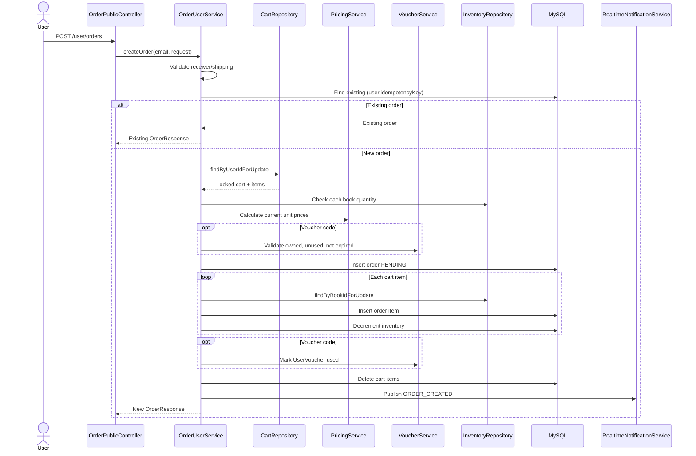
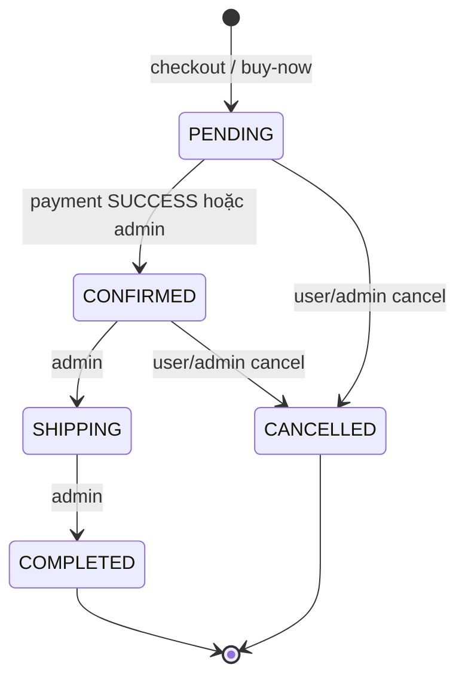
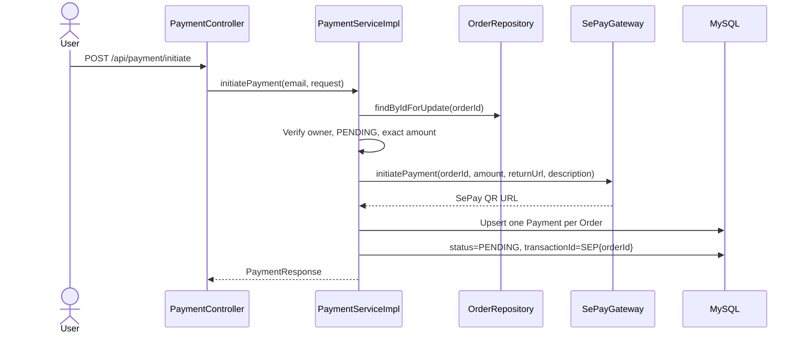
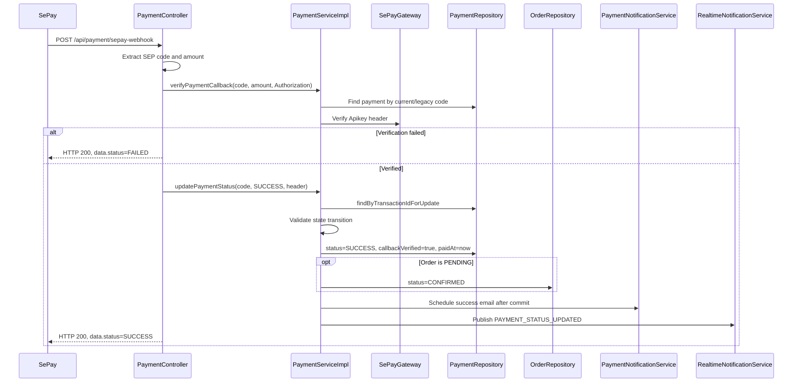
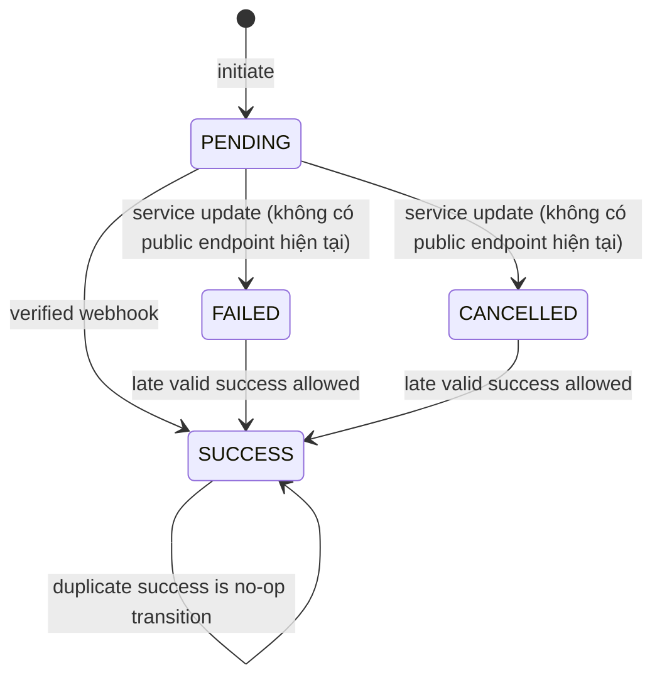

# Workflow Order và Payment

## Mục đích

Tài liệu mô tả chính xác workflow cart, checkout, inventory, voucher, order và SePay payment. Đây là tài liệu nghiệp vụ trung tâm; API paths chi tiết nằm tại [API Documentation](../03-api/api-documentation.md).

## Scope và nguồn kiểm chứng

- Cart: [`CartCommandServiceImpl`](../../Back_end/src/main/java/com/example/web_bansach/module/cart/service/impl/CartCommandServiceImpl.java), [`CartQueryServiceImpl`](../../Back_end/src/main/java/com/example/web_bansach/module/cart/service/impl/CartQueryServiceImpl.java), [`CartValidationServiceImpl`](../../Back_end/src/main/java/com/example/web_bansach/module/cart/service/impl/CartValidationServiceImpl.java).
- Order: [`OrderUserService`](../../Back_end/src/main/java/com/example/web_bansach/module/order/service/OrderUserService.java), [`OrderService`](../../Back_end/src/main/java/com/example/web_bansach/module/order/service/OrderService.java).
- Inventory/voucher/pricing: [`InventoryService`](../../Back_end/src/main/java/com/example/web_bansach/module/inventory/service/InventoryService.java), [`VoucherService`](../../Back_end/src/main/java/com/example/web_bansach/module/voucher/service/VoucherService.java), [`PricingServiceImpl`](../../Back_end/src/main/java/com/example/web_bansach/module/pricing/service/impl/PricingServiceImpl.java).
- Payment: [`PaymentServiceImpl`](../../Back_end/src/main/java/com/example/web_bansach/module/payment/service/impl/PaymentServiceImpl.java), [`PaymentController`](../../Back_end/src/main/java/com/example/web_bansach/module/payment/controller/PaymentController.java), [`SePayGateway`](../../Back_end/src/main/java/com/example/web_bansach/infrastructure/payment/SePayGateway.java).

## 1. Business Overview

Order được tạo trước payment. Khi checkout hoặc buy-now thành công, hệ thống tạo order `PENDING` và trừ inventory ngay. Payment thành công chuyển order `PENDING` sang `CONFIRMED`. Không có entity hoặc trạng thái stock reservation riêng.

Hai đường tạo order:

- **Checkout**: chuyển toàn bộ cart item hiện tại thành order item rồi làm rỗng cart.
- **Buy now**: tạo order cho một book/quantity mà không thay đổi cart.

## 2. Cart Workflow

### Add item

1. Xác định user theo email principal.
2. Validate book id/quantity và sách tồn tại.
3. Đọc inventory; từ chối nếu tổng quantity dự kiến vượt tồn.
4. Tìm hoặc tạo cart cho user.
5. Nếu book đã có, cộng quantity; nếu chưa, tạo cart item.
6. Lưu unit price hiện hành từ `PricingService`.

### Update/remove/clear

- Update kiểm tra item thuộc cart của principal và quantity mới không vượt tồn.
- Remove chỉ xóa item thuộc cart hiện tại.
- Clear xóa toàn bộ cart item theo cart id.
- Query cart join-fetch book/discount và tính lại giá/tổng tiền; giá lưu ở cart item không phải nguồn duy nhất cho checkout.

Cart command chạy trong transaction nhưng add/update/remove/clear hiện đọc cart bằng `findByUserId`, không lấy pessimistic lock. [`CartRepository.findByUserIdForUpdate`](../../Back_end/src/main/java/com/example/web_bansach/module/cart/repository/CartRepository.java) được dùng ở checkout để khóa cart trong lúc chuyển item sang order.

## 3. Checkout Workflow



Toàn bộ flow chạy trong `@Transactional(rollbackFor = Exception.class)`. Exception trước commit rollback order, item, inventory, voucher và cart changes.

## 4. Buy Now Workflow

`OrderUserService.buyNow` dùng cùng validation người nhận, pricing, shipping, voucher và idempotency. Khác biệt:

- Request bổ sung `bookId` và `quantity`.
- Book phải tồn tại và `deletedAt == null`.
- Inventory của một book được khóa trước khi tạo order.
- Chỉ một `OrderItem` được tạo.
- Cart không bị đọc hoặc xóa.

Service kiểm tra idempotency trước và sau khi lock inventory. Unique `(user_id, idempotency_key)` ở database là lớp bảo vệ bổ sung.

## 5. Pricing, Shipping và Voucher

### Pricing

`PricingServiceImpl.calculateBookPrice` trả giá gốc trừ phần trăm discount khi discount active và thời điểm hiện tại nằm trong khoảng start/end. Order item lưu unit price snapshot đã tính.

### Shipping

- `null`, blank hoặc `STANDARD`: `0`.
- `EXPRESS`: `30000`.
- Giá trị khác: business error.

`CreateOrderRequest.shippingFee` có validation không âm nhưng service không dùng giá trị client để tính tổng.

### Voucher

User phải claim voucher trước. Claim khóa voucher row, bảo đảm còn quantity/chưa hết hạn/chưa claim, tạo `UserVoucher`, rồi giảm `Voucher.quantity`. Checkout đọc owned voucher chưa dùng, tính:

```text
discount = min(itemsTotal × discountPercent / 100, maxDiscount)
total = max(itemsTotal + shippingFee - discount, 0)
```

Sau khi tạo order, `useOwnedVoucher` khóa `UserVoucher` và đặt `used=true`, `usedAt=now`. Hủy order không hoàn lại trạng thái voucher trong code hiện tại.

## 6. Order Lifecycle



`OrderService.isAllowedStatusTransition` cho phép cùng trạng thái trả về không lỗi. Ngoài các cạnh trên, transition bị từ chối. User/admin không thể cancel `SHIPPING`, `COMPLETED` hoặc order đã `CANCELLED`.

## 7. Inventory Deduction & Restoration

### Deduction

- Checkout thực hiện pre-check tất cả item, sau đó lock từng inventory bằng `PESSIMISTIC_WRITE`, kiểm tra lại và trừ quantity.
- Buy-now lock inventory trước khi lưu order item và trừ quantity.
- Không có `reserved_quantity`, reservation expiry hoặc background release.

### Restoration

User cancel và admin cancel đọc order items, lock inventory theo book và cộng lại `item.quantity`, sau đó đặt order `CANCELLED`.

Khác biệt: user cancel ném lỗi nếu không tìm thấy inventory; admin cancel bỏ qua inventory bị thiếu (`orElse(null)`). Đây là inconsistency cần review, không được sửa trong tài liệu.

## 8. Payment Initialization và SePay QR



`SePayGateway` chỉ tạo URL QR; không gọi SePay refund/status API. `PaymentRequest.returnUrl` bắt buộc không rỗng trong service dù gateway có default return URL.

## 9. Webhook Processing



Webhook không tin status từ payload; controller gọi update với `SUCCESS` sau khi code/amount/API key hợp lệ.

## 10. Payment Status Lifecycle



`validatePaymentStatusTransition` từ chối thay đổi ra khỏi `SUCCESS`; từ `FAILED`/`CANCELLED` chỉ cho phép lên `SUCCESS`. Controller hiện chỉ gọi `SUCCESS` cho webhook. `FAILED`/`CANCELLED` không có endpoint cập nhật được phát hiện.

## 11. Transaction Management và Concurrency

**Checkout từ cart** khóa cart và từng inventory. Order, order items, inventory,
voucher và cart được cập nhật trong cùng transaction.

**Buy-now** khóa inventory của book. Order, order item, inventory và voucher
được cập nhật nguyên tử.

**Cancel** khóa từng inventory trước khi hoàn quantity và đổi order status.

**Voucher claim/use** lần lượt khóa voucher và user-voucher để tránh cấp hoặc
dùng trùng trong các request đồng thời.

**Payment init** khóa order trước khi validate và upsert payment. **Webhook**
khóa payment trước khi cập nhật payment và có thể confirm order.

Lock methods: [`CartRepository.findByUserIdForUpdate`](../../Back_end/src/main/java/com/example/web_bansach/module/cart/repository/CartRepository.java), [`InventoryRepository.findByBookIdForUpdate`](../../Back_end/src/main/java/com/example/web_bansach/module/inventory/repository/InventoryRepository.java), [`OrderRepository.findByIdForUpdate`](../../Back_end/src/main/java/com/example/web_bansach/module/order/repository/OrderRepository.java), [`PaymentRepository.findByTransactionIdForUpdate`](../../Back_end/src/main/java/com/example/web_bansach/module/payment/repository/PaymentRepository.java).

## 12. Idempotency và Duplicate Webhook

### Order idempotency

- Optional client `idempotencyKey`, tối đa 64 ký tự.
- Lookup theo `(userId, normalizedKey)` trả order đã tạo nếu có.
- Database unique constraint `(user_id, idempotency_key)`.
- Nếu key null/blank, không có idempotency guarantee.

### Webhook duplicate handling

- Payment row bị pessimistic-lock khi update.
- Duplicate `SUCCESS` được transition validator chấp nhận nhưng `shouldSendSuccessEmail=false`, nên không gửi lại success email.
- Order chỉ được auto-confirm nếu còn `PENDING`.
- Payment status/signature/callback timestamp vẫn được save lại và realtime event vẫn được publish.
- Không có bảng webhook event, provider event id hoặc request hash để deduplicate độc lập. Vì vậy chống duplicate là **PARTIAL**, dựa trên payment state chứ không phải webhook identity.

## 13. Failure Scenarios

- **Cart rỗng:** từ chối checkout.
- **Thiếu inventory hoặc không đủ quantity:** trả business error và rollback
  checkout.
- **Voucher không thuộc user, đã dùng hoặc hết hạn:** trả business error.
- **Idempotency key đã tồn tại:** trả order hiện hữu.
- **Payment không thuộc user:** từ chối init hoặc xem status.
- **Amount không khớp order total:** từ chối init hoặc callback verification.
- **Order không còn `PENDING`:** không cho init payment.
- **Webhook thiếu code/amount:** trả HTTP 400.
- **API key sai hoặc payment không khớp:** trả HTTP 200 với payload `FAILED`.
- **Payment success khi order không `PENDING`:** payment vẫn thành `SUCCESS`,
  nhưng callback không đổi order status.
- **Cancel order `SHIPPING`/`COMPLETED`:** từ chối và không hoàn kho.

## 14. Realtime Notifications

- `ORDER_CREATED`, `ORDER_CANCELLED`, `ORDER_STATUS_UPDATED` được publish qua WebSocket topics.
- `PAYMENT_INITIATED`, `PAYMENT_STATUS_UPDATED` được publish qua WebSocket; payment update còn gửi tới SSE emitters theo order.
- Khi subscribe SSE, controller kiểm tra status/ownership và gửi snapshot hiện tại trước khi chờ event mới.
- Realtime event không phải source of truth; client cần đối chiếu REST payment/order status.

## 15. Business Rules & Invariants

- Order total được backend tính từ unit price hiện hành, shipping rule và voucher; không tin total từ client.
- Payment amount phải đúng bằng `Order.totalAmount` (`BigDecimal.compareTo == 0`).
- Một order có tối đa một payment row.
- Inventory không được âm qua các service path đã kiểm tra.
- Order item giữ price snapshot; discount thay đổi sau đó không sửa order cũ.
- User chỉ xem/hủy order và payment thuộc mình; admin được xem payment status bất kỳ.
- Voucher đã dùng không được tự hoàn lại khi cancel.

## 16. Known Limitations & Unverified Findings

- Không có stock reservation/expiry; order chưa thanh toán vẫn giữ phần inventory đã trừ vô thời hạn.
- Không có automatic timeout/cancel cho `PENDING` order/payment.
- Không có refund flow.
- Shipping chỉ có hard-coded `STANDARD`/`EXPRESS`; request field shipping fee không được dùng.
- Cancel không hoàn voucher ownership state.
- Admin/user cancel xử lý missing inventory khác nhau.
- Realtime publish không dùng transactional outbox; delivery sau commit và failure behavior là **UNVERIFIED**.
- Payment callback authenticity chỉ dựa trên static API-key header cộng code/amount; không có cryptographic payload signature verification trong source.
- Race behavior, deadlock handling và retry dưới tải đồng thời là **UNVERIFIED**.
- Email/WebSocket/SSE end-to-end chưa được chạy trong audit này.

