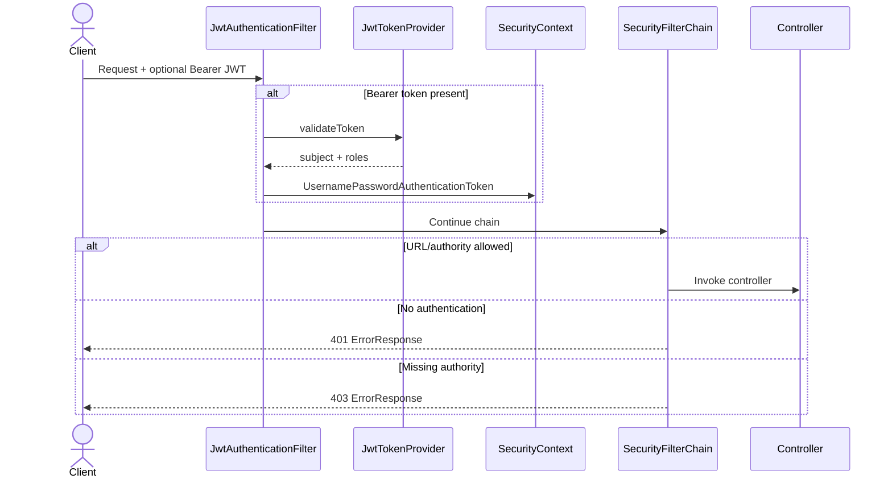
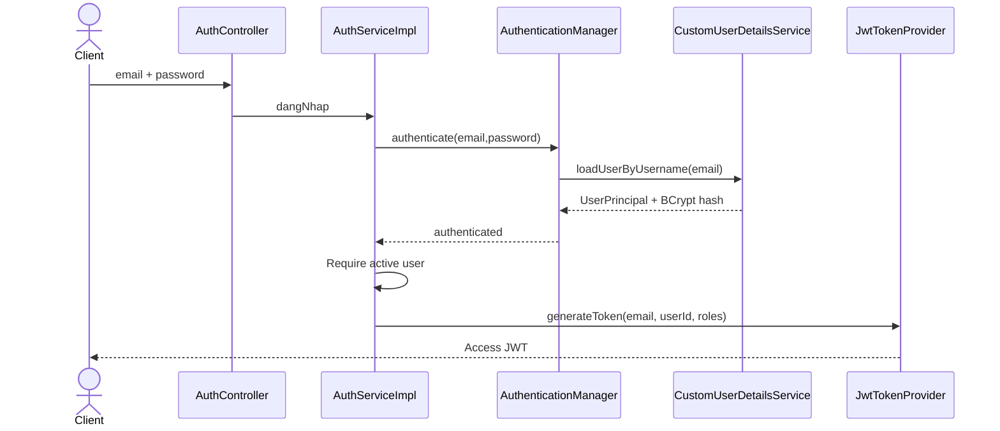

# Thiết kế bảo mật

## Mục đích

Tài liệu mô tả authentication, authorization, JWT, account lifecycle, webhook/realtime security và error handling đang có. Các rủi ro được ghi để review; tài liệu không thay đổi security configuration.

## Scope và nguồn kiểm chứng

- Filter chain và URL rules: [`SecurityConfig`](../../Back_end/src/main/java/com/example/web_bansach/security/config/SecurityConfig.java), [`Endpoints`](../../Back_end/src/main/java/com/example/web_bansach/security/config/Endpoints.java).
- JWT: [`JwtTokenProvider`](../../Back_end/src/main/java/com/example/web_bansach/security/jwt/JwtTokenProvider.java), [`JwtAuthenticationFilter`](../../Back_end/src/main/java/com/example/web_bansach/security/jwt/JwtAuthenticationFilter.java), [`JwtProperties`](../../Back_end/src/main/java/com/example/web_bansach/security/jwt/JwtProperties.java).
- Authentication/account: [`AuthServiceImpl`](../../Back_end/src/main/java/com/example/web_bansach/module/user/service/impl/AuthServiceImpl.java), [`AccountVerificationServiceImpl`](../../Back_end/src/main/java/com/example/web_bansach/module/auth/service/impl/AccountVerificationServiceImpl.java).
- Security errors: [`JwtAuthenticationEntryPoint`](../../Back_end/src/main/java/com/example/web_bansach/security/handler/JwtAuthenticationEntryPoint.java), [`JwtAccessDeniedHandler`](../../Back_end/src/main/java/com/example/web_bansach/security/handler/JwtAccessDeniedHandler.java).

## 1. Security Overview

Backend dùng Spring Security theo mô hình stateless access JWT và RBAC với `ROLE_USER`, `ROLE_ADMIN`. URL authorization được cấu hình theo HTTP method/path; nhiều controller còn có `@PreAuthorize`, tạo defense-in-depth nhưng cũng yêu cầu hai danh sách rule được giữ đồng bộ.

Không có OAuth2/OIDC, refresh token, server-side session, logout/revocation endpoint hoặc token blacklist trong source hiện tại.

## 2. Authentication Architecture

`JwtAuthenticationFilter` chỉ thiết lập authentication khi token hợp lệ và context chưa có authentication. Principal name là JWT subject (email); authorities được lấy từ roles claim.

## 3. Registration & Email Verification

1. [`AuthServiceImpl.taoTaiKhoanMoi`](../../Back_end/src/main/java/com/example/web_bansach/module/user/service/impl/AuthServiceImpl.java) kiểm tra email và username.
2. Password được BCrypt encode; user mới có `isActive=false` và role `ROLE_USER` lấy từ database.
3. [`AccountVerificationServiceImpl.issueVerificationCode`](../../Back_end/src/main/java/com/example/web_bansach/module/auth/service/impl/AccountVerificationServiceImpl.java) tạo mã 6 chữ số bằng `SecureRandom`.
4. Chỉ BCrypt hash của mã được lưu; mã thô chỉ dùng để render email.
5. Mã cũ chưa dùng bị invalid trước khi phát mã mới.
6. Resend áp dụng cooldown; verify áp dụng TTL và giới hạn failed attempts từ configuration.
7. Verify thành công đánh dấu code used và activate user trong transaction; welcome email được publish after commit.

Nếu đăng ký lại email của inactive user, service gửi lại verification code thay vì tạo user mới. Verification method dùng `noRollbackFor = BusinessException` để lưu failed attempt/used state ngay cả khi trả lỗi nghiệp vụ.

## 4. Login Workflow

Bad credentials và inactive/nonexistent user đều trả thông báo credential không hợp lệ, giảm account-status disclosure tại login.

## 5. JWT Structure & Validation

- Signing algorithm là HS256; HMAC key được tạo từ configured secret bằng `Keys.hmacShaKeyFor`.
- Subject: email.
- Custom claims: `userId`, `roles`.
- Standard timestamps: issued-at và expiration.
- Default expiration configuration: 1,800,000 ms nếu không override.
- Validation parse chữ ký và claims; expired/malformed/unsupported/invalid signature trả false và filter không authenticate.

Secret được đọc từ environment-backed application property. Tài liệu không ghi giá trị secret. Độ dài/entropy secret ở từng environment là **UNVERIFIED**.

Không có refresh token. Khi access JWT hết hạn, client phải đăng nhập lại. Không có server-side revoke khi đổi password, disable user hoặc logout; token đã phát có thể còn hợp lệ đến expiry vì filter không tải lại trạng thái user trên mỗi request.

## 6. Password Hashing và Reset

- Password registration/change/reset dùng `BCryptPasswordEncoder` mặc định.
- Change password xác minh current password và confirmation trước khi encode password mới.
- Forgot-password không tiết lộ email có tồn tại: endpoint trả cùng success message; service chỉ gửi email khi tìm thấy user.
- Reset token là UUID, TTL cố định 30 phút, unique và single-use.
- Reset token hiện được lưu trực tiếp trong database, không hash.
- Không phát hiện logic vô hiệu hóa mọi reset token cũ khi tạo token mới hoặc sau password change.

Nguồn: [`AuthServiceImpl.quenMatKhau/datLaiMatKhau`](../../Back_end/src/main/java/com/example/web_bansach/module/user/service/impl/AuthServiceImpl.java), [`UserProfileServiceImpl`](../../Back_end/src/main/java/com/example/web_bansach/module/user/service/impl/UserProfileServiceImpl.java).

## 7. Authorization & RBAC

Spring authorities dùng exact strings `ROLE_USER`, `ROLE_ADMIN` với `hasAuthority`/`hasAnyAuthority`. `ROLE_ADMIN` được cho phép trên phần lớn user endpoint.

### Endpoint access matrix

- **`/tai-khoan/**` sáu endpoint hiện có · Có**
  - USER: Có
  - ADMIN: Có
  - Enforcement chính: URL rules
- **GET `/user/books/**` · Có**
  - USER: Có
  - ADMIN: Có
  - Enforcement chính: URL rules
- **GET `/api/categories/**`, `/api/authors/**` · Có**
  - USER: Có
  - ADMIN: Có
  - Enforcement chính: URL rules
- **`/user/cart/**` · Không**
  - USER: Có
  - ADMIN: Có
  - Enforcement chính: URL + class `@PreAuthorize`
- **`/user/orders/**` · Không**
  - USER: Có
  - ADMIN: Có
  - Enforcement chính: URL + class `@PreAuthorize`
- **`/user/reviews/**` · Không**
  - USER: Có
  - ADMIN: Có
  - Enforcement chính: URL + class `@PreAuthorize`
- **`/user/wishlist/**`, `/user/vouchers/**` · Không**
  - USER: Có
  - ADMIN: Có
  - Enforcement chính: URL + class `@PreAuthorize`
- **`/user/inventory/**` · Không**
  - USER: Có
  - ADMIN: Có
  - Enforcement chính: URL + class `@PreAuthorize`
- **Payment init/status · Không**
  - USER: Có
  - ADMIN: Có
  - Enforcement chính: URL rules + ownership in service
- **`/admin/**`, `/api/admin/**` · Không**
  - USER: Không
  - ADMIN: Có
  - Enforcement chính: URL + phần lớn class `@PreAuthorize`
- **`/user_for_admin/**` · Không**
  - USER: Không
  - ADMIN: Có
  - Enforcement chính: Method `@PreAuthorize` + URL rules
- **Actuator health/prometheus · Có**
  - USER: Có
  - ADMIN: Có
  - Enforcement chính: Explicit permitAll
- **WebSocket handshake/destinations `/ws`, `/app`, `/topic`, `/queue` · Có**
  - USER: Có
  - ADMIN: Có
  - Enforcement chính: Explicit permitAll

Full endpoint catalog: [API Documentation](../03-api/api-documentation.md).

### Object-level authorization

- Order detail/cancel query theo cả `orderId` và current `userId`.
- Payment init/status kiểm tra payment/order owner trừ khi caller có `ROLE_ADMIN`.
- Review update/delete kiểm tra owner; admin có endpoint delete riêng.
- Cart/wishlist/voucher service lấy user từ authenticated email.
- Admin endpoint được role-check nhưng không có permission granularity ngoài `ROLE_ADMIN`.

## 8. Security Filter Chain

Thứ tự/chính sách chính trong [`SecurityConfig.securityFilterChain`](../../Back_end/src/main/java/com/example/web_bansach/security/config/SecurityConfig.java):

1. Áp dụng configured CORS.
2. Disable CSRF.
3. `SessionCreationPolicy.STATELESS`.
4. Cấu hình JSON handlers cho 401/403.
5. Permit `OPTIONS`, realtime paths và selected actuator paths.
6. Permit public GET/POST arrays.
7. Enforce USER arrays theo HTTP method.
8. Enforce ADMIN arrays theo HTTP method.
9. Mọi request còn lại phải authenticated.
10. Chèn JWT filter trước `UsernamePasswordAuthenticationFilter`.

Method security được bật bằng `@EnableMethodSecurity`.

## 9. CORS & CSRF

- Allowed origins lấy từ comma-separated `app.cors.allowed-origins`; không dùng wildcard trong source.
- Allowed methods: GET, POST, PUT, DELETE, OPTIONS.
- Allowed headers: `*`; exposed header: `Authorization`.
- Credentials được cho phép; max age 3600 giây.
- CSRF disabled vì backend dùng bearer JWT và stateless session.

Nếu token được lưu hoặc truyền qua cookie ở tương lai, quyết định CSRF phải được review lại. Frontend hiện có token storage client; exact browser storage security nằm ngoài backend scope và cần frontend review.

## 10. Webhook Authentication

`POST /api/payment/sepay-webhook` là public ở filter chain để SePay gọi được. Controller/service áp dụng application-level verification:

1. Trích payment code `SEP{orderId}` hoặc legacy `SEP-{orderId}`.
2. Trích amount.
3. Tìm payment record và yêu cầu amount exact match.
4. `SePayGateway.verifyPayment` yêu cầu `Authorization` đúng `Apikey <configured-key>`.
5. Payment row được pessimistic-lock khi update.

Đây là static API-key authentication, không phải chữ ký HMAC của payload. Callback signature field lưu nguyên Authorization header; nếu header chứa API key, việc lưu này làm tăng phạm vi dữ liệu nhạy cảm trong database và cần security review.

## 11. WebSocket & SSE Security

### WebSocket

- Handshake `/ws/**` và broker paths `/app/**`, `/topic/**`, `/queue/**` được `permitAll` ở HTTP security.
- [`WebSocketConfig`](../../Back_end/src/main/java/com/example/web_bansach/common/config/WebSocketConfig.java) không khai báo inbound channel interceptor hoặc message-level authorization.
- Topic gồm global order/payment topics và username/order-specific topics.

Do đó confidentiality của realtime messages là một rủi ro cần review; không có bằng chứng subscriber authorization trong backend source.

### SSE

- HTTP path được permit public để EventSource có thể kết nối.
- Controller yêu cầu query parameter `token`, validate JWT, lấy roles và gọi payment status service để kiểm tra owner/admin trước subscribe.
- Token trong URL có nguy cơ bị ghi vào access log, browser history hoặc monitoring. Đây là risk, không phải bằng chứng token đã bị lộ.

## 12. Security Error Handling

Application errors đi qua `GlobalExceptionHandler` và dùng `ApiResponse`:

- 400: validation/business/illegal argument.
- 401: bad credentials hoặc explicit `UnauthorizedException`.
- 403: `ForbiddenException`.
- 404: resource not found.
- 500: generic message, stack trace chỉ log server-side.

Filter-chain failures dùng `ErrorResponse`:

- 401: `AUTHENTICATION_ERROR`.
- 403: `ACCESS_DENIED`.

Hai schema khác nhau là limitation cho API consumer. Handler log exception; [`LogMaskingUtil`](../../Back_end/src/main/java/com/example/web_bansach/common/logging/LogMaskingUtil.java) được dùng ở một số auth/order/payment log để mask email, nhưng masking không được enforce tập trung cho mọi logger.

## 13. Existing Security Controls

- BCrypt cho password và verification code.
- SecureRandom cho verification code.
- Generic login/forgot-password responses giảm user enumeration.
- Verification TTL/cooldown/max-attempts.
- Reset token TTL và single-use flag.
- Stateless signed JWT với expiry.
- URL RBAC cộng method security.
- Object ownership check cho order/payment/review/cart-related operations.
- Exact payment amount check và webhook API key.
- Pessimistic lock cho sensitive concurrent updates.
- DTO validation và centralized error handling.
- CORS allowlist qua environment configuration.
- Request id trong logging MDC.

## 14. Security Risks & Limitations

### Mức High

- WebSocket endpoints/topics được permit all và chưa phát hiện cơ chế authorize
  subscription/message.
- Webhook Authorization header được lưu vào `callbackSignature`; static API key
  có thể bị lưu trong database.

### Mức Major

- SSE truyền JWT qua query parameter.
- Không có refresh rotation/revocation; JWT của user bị disable hoặc xóa không
  được kiểm tra lại trên mỗi request.
- Reset token được lưu plaintext và token cũ không bị invalid hàng loạt.
- Không phát hiện rate limiting cho login, forgot-password hoặc webhook.
- URL rule arrays và method annotations có thể drift; chưa thấy authorization
  integration test bao phủ toàn bộ matrix.

### Mức Minor

- Application error và security error chưa dùng chung schema.
- CORS cho phép mọi request header và credentials; tính đúng đắn phụ thuộc origin
  configuration của từng môi trường.

Không phát hiện secret hard-code trong tài liệu này. Giá trị credential ở runtime không được audit/hiển thị.

## 15. Unverified Findings

- Entropy/rotation/access control của JWT, SePay, SMTP và Cloudinary secrets trong môi trường thực.
- TLS termination và security headers ở ingress/reverse proxy.
- Rate limiting/WAF bên ngoài application.
- RabbitMQ/Redis/MySQL network isolation và authentication production.
- Token storage behavior và XSS controls của frontend.
- WebSocket subscription confidentiality end-to-end.
- Penetration test, dependency vulnerability scan và incident response process.
